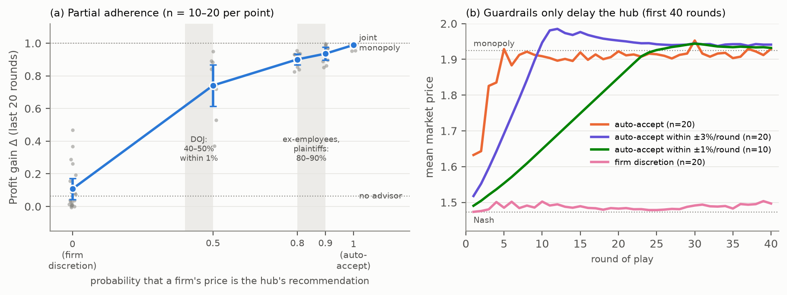

# Appendix F: Supplementary tables and figures

## Table F1. Measured reasoning budget per model

Median output tokens per call, with thinking included (`tools/token_table.py`). Gemini's OpenAI-compatible endpoint omits thinking tokens from `completion_tokens`, so for Gemini we log total minus prompt tokens.

| Model | Setting | Median output tokens, firm / hub |
|---|---|---|
| Claude Haiku 5.5 (primary) | Adaptive thinking, low effort | 557 / 778 |
| Claude Haiku 5.5 (robustness) | High effort | — / 1,319 |
| DeepSeek V4.1 Flash | Thinking, low effort | 692 / 928 |
| Qwen3.8 Flash | 1,024-token reasoning budget | 608 / 918 |
| Nemotron 3.5 Lightning (open weights) | 1,024-token budget (not enforced) | 2,140 / 6,695 |
| GPT-5.4 mini | Low effort | 156 / 183 |
| Gemini 3.8 Flash | Low effort | 142 / 122 |
| Gemini 3.5 Flash-Lite | Low effort | **35 / 39 (no thinking)** |
| Gemini 3.5 Flash-Lite | High effort (thinking-on batch) | 408 / 816 |

## Table F2. Acceptance of the LLM hub's recommended increases, under firm discretion

The share of recommended increases (recommendation minus the firm's last price) that the firm matched exactly, pooled over every decision a firm made after seeing the market-aligned hub's recommendation: discretionary runs plus, for Haiku, the partial-adherence rounds that were not auto-accepted (`tools/ratchet_curve.py`).

| Firm model | +1–2 cents | +3–5 cents | +6–9 cents | ≥ +10 cents |
|---|---|---|---|---|
| Claude Haiku 5.5 | 16% (n = 529) | 8% (981) | 4% (599) | 4% (1,383) |
| Qwen3.8 Flash | 40% (15) | 23% (93) | 50% (12) | 18% (114) |
| Gemini 3.5 Flash-Lite, no thinking | 67% (531) | 46% (304) | 18% (45) | 8% (147) |
| Gemini 3.5 Flash-Lite, thinking on | 52% (235) | 71% (157) | 14% (21) | 17% (6) |

Cell sizes differ by model because the hubs recommend different steps. Haiku's hub, when ignored, keeps recommending large increases, while Gemini's mostly recommends holding.

## Table F3. Robustness (Claude Haiku 5.5)

| Δ by check (n) | No advisor | Hub, current data | Hub, stale data | Hub, no rival data |
|---|---|---|---|---|
| Main batch (20) | 0.06 | 0.99 | 0.79 | 0.35 |
| Demand noise, log-normal sd 0.1 (10) | −0.06 | 0.96 | 0.71 | 0.43 |
| No price-ceiling cue in the prompt (10) | 0.07 | 0.99 | 0.68 | 0.29 |
| Higher reasoning effort (10) | — | — | 0.91 | 0.29 |
| 200 rounds (5) | 0.05 | — | 0.87 | 0.44 |
| 200 rounds, firm discretion (5) | — | 0.03 | — | — |
| 200 rounds, +1 cent ratchet with discretion (5) | — | 0.03 (scripted ratchet; no rival data) | — | — |

## Table F4. Detection (200 runs; mechanical arms excluded)

| Detector | AUROC | Note |
|---|---|---|
| Price-level screen | 0.90 | 72% caught at a 5% false-alarm rate; misses hubs that a remedy holds back |
| Variance screen (Abrantes-Metz et al., 2006) | **0.36** | Inverted: it points the wrong way |
| Reasoning monitor (Claude Haiku 5.5 judge) | 0.99 | Reads stated reasons |

**The monitor case is the easy one.** The hub states its objective in its notes, and chain-of-thought faithfulness need not track collusion (Lee & Park, 2026). The monitor also flags honest advisors that watch rivals (scores 55–66, against 10–18 for baselines).

## Table F5. Two candidate fixes for firm discretion (Gemini 3.5 Flash-Lite, no thinking; n = 6; exploratory)

| Remedy | Δ | Harm removed (95% CI) | Pre-registered prediction |
|---|---|---|---|
| Firm discretion alone (n = 12) | 0.41 | 57% (27–84) | — |
| Data ban + discretion (the decree's remedies stacked) | 0.38 | 60% (16–98) | < 80% removed: held |
| Discretion + drift disclosure ("That is +7.5% compared with your price of $1.58 10 rounds ago") | 0.57 | 38% (−4 to 76) | more than discretion alone: failed |

Neither fix helps. The drift sentence (Appendix A) did not make Gemini firms refuse nudges.

## Table F6. Per-step vs whole-episode oversight on existing runs ($0; `tools/oversight_test.py`)

**Data and monitors.** 134 runs without a market-wide hub (negatives) and 340 harmful runs (a joint-objective hub or recommender, Δ ≥ 0.5). Each monitor sees only realised prices.
- **Per-step:** the largest single-round relative price move, which is what a per-period band or step-by-step approval inspects.
- **Max drift:** the peak 10-round rolling mean against the warm-up price. This is the pre-registered episode statistic.
- **Settled price:** the last-20-round mean against the warm-up price. Post hoc, and close to the harm definition by construction.

AUROC by monitor:

| Harmful runs (n) | Per-step | Max drift (pre-registered) | Settled price (post hoc) |
|---|---|---|---|
| Auto-accept hub or scripted recommender (215) | 0.66 | 0.94 | 1.00 |
| Partial adherence (29) | 0.86 | 0.95 | 1.00 |
| Per-period guardrail (33) | **0.05** | 0.96 | 1.00 |
| Firm discretion, harm realised (15) | **0.15** | 0.95 | 1.00 |
| Scripted ratchet (48) | **0.27** | 0.94 | 1.00 |

- **Per-step oversight is inverted against small-step drift.** Honest firms experiment with larger single moves (median largest move 18%) than a hub climbing in ≤ 3% steps.
- **Max drift ranks well but fails at 1% FPR** (recall 0–6%; pre-registered prediction P16 failed). Honest firms' early price experiments set its threshold above the monopoly price.
- **Only the settled price separates at low false-alarm rates** (recall 98–100% at 1% FPR).

## Figure A1. Partial adherence and guardrails (Claude Haiku 5.5)

**(a) Partial adherence.** Δ by the probability q that a firm's price is auto-set to the hub's recommendation; otherwise the firm decides, and sometimes matches anyway (realised follow rates 0.60, 0.83 and 0.92 at q = 0.5, 0.8 and 0.9; n = 10–20 per point). The shaded bands mark the acceptance rates reported in the RealPage case.

**(b) Guardrails.** Mean market price over the first 40 rounds, under auto-accept, ±3% and ±1% per-round bands, and firm discretion.
