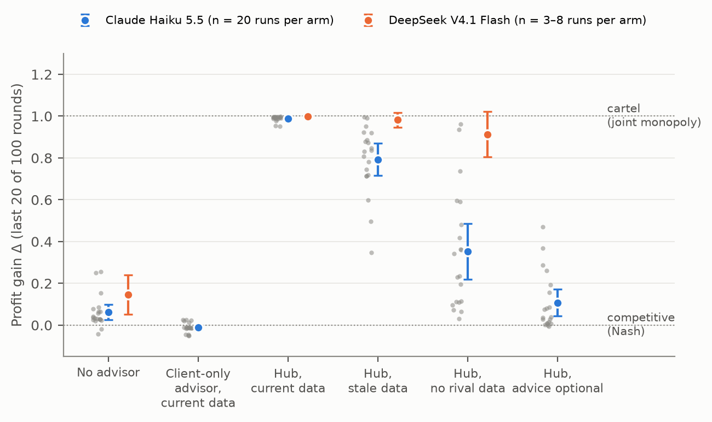
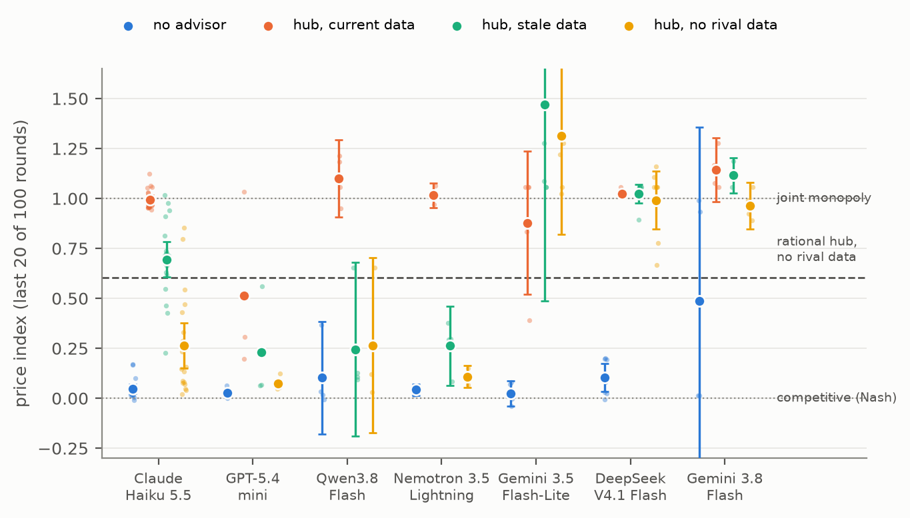
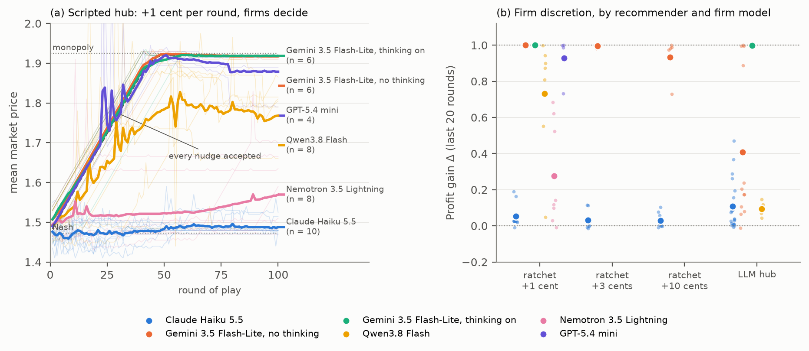

# An LLM Pricing Hub Survives Data Limits on Some Models; Firm Discretion Works Only When Firms Refuse Small Nudges

*Pre-registered tests of the RealPage Final Judgment's remedies (data bans, stale data, parameterised auto-accept, firm discretion) on LLM pricing advisors from six labs*

**Author:** Ebin [full name and affiliation: author to confirm]
**Track:** 1, Markets and Collusion
**Sprint question:** 1.5, "Which single restriction removes the most collusion at the least cost?"
**Code and logs:** https://github.com/ebt55/llm-pricing-hub-remedies

<!--
*Draft v5, Sun 25 Oct ~05:15 IST.*
- *Title, abstract and edits from the Fable 5.1 review (SPRINT_LOG 05:04).*
- *Confirmatory results were pre-registered before the main batch (freeze commit `5aa9f79`). Every later batch was logged in `SPRINT_LOG.md` with a prediction before it ran.*
- *GPT-5.4 mini has n = 3 (seeds 200–202). Seeds 203–204 are scheduled for the Mon 05:30 IST allowance reset, and will be added if they finish before Mon 12:00 IST.*
-->

## Abstract

Shared pricing software can align competitors' prices without any agreement; that is the theory of the US case against RealPage. Its 2026 Final Judgment limits what the software may see (no current rival data) and do (auto-accept only within user-set parameters). We test these remedies on an LLM pricing hub told to maximise its clients' combined profit, in a repeated logit Bertrand duopoly (666 runs; seven models from six labs; pre-registered main batch). With Claude Haiku 5.5 the hub raises profit gain Δ (1 = joint monopoly) from 0.06 to 0.99 (n = 20 per arm). Each remedy's effect depends on the model. A data ban removes 69–92% of the harm for Haiku, Qwen3.8 Flash and Nemotron 3.5 Lightning, but at most 10% for DeepSeek V4.1 Flash and Gemini 3.5 Flash-Lite. Auto-accept within ±1–3% per round retains all of it and only delays monopoly (Haiku). Firm discretion removes 95% for Haiku (holding over 200 rounds) and ~100% for Qwen, but 57% for Gemini Flash-Lite (95% CI 27–84; n = 12). The hub works as a ratchet of small steps: a scripted recommender adding 1 cent per round, under discretion, gives Δ 0.05, 0.35, 0.64 and 1.00 for Haiku, Nemotron, Qwen and Gemini Flash-Lite, in the order of how often each firm model accepts 1–2-cent nudges (12% to 61%). Remedies should constrain the advisor's objective and audit acceptance and outcomes; our open harness lets a court-appointed monitor run that test on a vendor's model.

## 1. Introduction

**The premise.** We study a pricing advisor whose objective is aligned with the whole market rather than with its own client. This is the incentive alleged against RealPage: a vendor rewarded when rents rise across its clients.
- We instruct this objective, so we measure capability under instruction, not unprompted propensity. §4.5 tests a softer, realistic version.
- "Collusion" here means sustained supracompetitive prices, measured as profit gain Δ (Calvano et al., 2020).

We ask a policy question conditional on the premise: if such a hub exists, do the remedies regulators imposed stop it? This is the sprint's question 1.5, "Which single restriction removes the most collusion at the least cost?", asked of the restrictions a court actually imposed.

**The remedies.** The DOJ–RealPage Final Judgment (M.D.N.C. 1:24-cv-710, entered 19 May 2026) bans competitors' non-public data from runtime pricing. It allows non-public training data only if it is at least 12 months old, and forbids sub-state geographic models. It allows auto-accept only if each user sets its parameters (§V.A.1), and bars features that impede overriding a recommendation (§V.A.5) or reward accepting one (§V.C). Landlord consent decrees bar software that *requires* acceptance.

**Contributions:**
1. **A test of the Final Judgment's terms on LLM advisors.** A data ban removes 69–92% of the hub's harm on three models and at most 10% on two. Parameterised auto-accept and partial adherence retain 73–101% (Haiku).
2. **A mechanism with a causal test.** The hub raises prices by a ratchet of small steps. With the recommender fixed by script, four firm models' outcomes (Δ 0.05 to 1.00) rise with how often they accept 1–2-cent nudges (12% to 61%).
3. **An open, pre-registered harness** that a court-appointed monitor could run on a vendor's model before approving a remedy.

## 2. Related work

**LLM pricing collusion.** Q-learning agents learn supracompetitive prices in a repeated logit Bertrand market (Calvano et al., 2020). So do GPT-4 agents (Fish et al., 2024) and reasoning models (Riemer et al., 2026, whose llm-cartel code we build on). Such collusion erodes when agents differ (Keppo et al., 2026).

**Shared algorithms and the law.** Sellers sharing one AI model can price supracompetitively when its recommendations are correlated enough (Cao and Hu, 2026). Liability turns on pooled non-public data and on adherence (Berger et al., 2025). *Gibson v. Cendyn* (9th Cir. 2025) upheld dismissal where recommendations were optional. *Cornish-Adebiyi v. Caesars* (3d Cir. 2026) revived a claim that cited pooled data and about 90% acceptance.

**Interventions.** In LLM markets, the evidence is model-specific: anti-collusion prompts (Riemer et al., 2026), announced price caps (Dhanda, 2026), enforced governance (Bracale Syrnikov et al., 2026), and untested mappings of human remedies (Idowu et al., 2026). These act on firms' prompts, rules or rivals; ours act on a third-party advisor's information and authority. To our knowledge, no prior work tests the RealPage remedies on LLM advisors. On detection, price-level audits can be blind by construction (Xu et al., 2026). Concurrent sprint work (zerocommcartel, 2026) varies what firms are told about rivals' advisors in a one-shot Cournot game. We vary the advisor's data access and the firms' adherence in a repeated Bertrand market.

## 3. Setup

**Market.** A logit Bertrand duopoly with Calvano et al.'s (2020) parameters (a = 2, μ = 0.25, c = 1), with Nash price p_N = 1.473 and joint-monopoly price p_M = 1.925. Every run starts from 10 rounds of competitive history (Nash ± 5 cents).
- **Profit gain** Δ = (π − π_N)/(π_M − π_N), averaged over the last 20 of 100 rounds: 0 is competitive and 1 is joint monopoly. The unit of analysis is the run.
- **Price index** (p̄ − p_N)/(p_M − p_N), used for cross-model comparisons because Δ falls again above p_M.

**Firms.** Firms use the P0 prompt of Fish et al. (2024), via llm-cartel, plus one sentence: the firm competes with one other firm whose prices and sales it does not observe. They see their own price, quantity and profit history, plus the software's recommendations when advised (Appendix A).

**The hub** is called once per firm per round, with the same model as the firms.
- **Objective:** either the client's long-run profit, or the *market-aligned* objective, "the combined profit of all firms in your client's market". The prompts are otherwise identical, and none says the hub advises the rival.
- **What it sees about the rival:** price and quantity through t−1 (*current*), the same data but ≥ 10 rounds old (*stale*), nothing (*none*, the decree's data ban), or a market average (*aggregate*, triopoly only).

**Adherence regimes:**
- **Auto-accept:** the price is the recommendation.
- **Guardrailed:** auto-applied, but clipped to ±3% or ±1% of the firm's last price. This mirrors §V.A.1's user-set parameters; ±3% is the daily default cited in the DOJ complaint.
- **Partial:** each firm's price is the recommendation with probability q, and otherwise the firm decides.
- **Firm discretion:** the firm sets every price itself after seeing the recommendation.

**Scripted recommenders** (no LLM): a static monopoly price, best-response dynamics, a rational joint-profit hub, and a **ratchet**. The ratchet recommends the client's own last price plus 1, 3 or 10 cents, capped at p_M. It re-anchors after a rejection, and the firm sees only the number.

**Models.**
- **Primary:** Claude Haiku 5.5, with adaptive thinking at low effort.
- **Replications:** DeepSeek V4.1 Flash, Qwen3.8 Flash, Nemotron 3.5 Lightning (open weights), GPT-5.4 mini, Gemini 3.8 Flash and Gemini 3.5 Flash-Lite. Model IDs are logged on every call, and OpenRouter models are pinned to one provider.
- **Measured reasoning budgets** (Table F1), because settings were not honoured uniformly. Median output tokens per call range from 35 (Gemini Flash-Lite at low effort, which does not think) to 6,376 (Nemotron, whose 1,024-token budget was not enforced).

**Statistics.**
- Welch t tests and intervals, plus Mann-Whitney, with Holm correction within each pre-registered stage.
- Share of harm removed = (Δ_M2-a − Δ_X)/(Δ_M2-a − Δ_B0), with a bootstrap 95% CI. The MDE is reported for every contrast.
- n = 20 per primary Haiku arm (raised from 10 after the pilot), n = 4–12 for the other models, and n = 2–3 for the Gemini thinking-on batch, which stopped at a spending cap.

## 4. Results

### 4.1 Controls *(confirmatory)*

The mechanical controls give Δ = 1.00 (static monopoly) and 0.01 (best response), and the no-advisor baseline B0 is 0.06 (n = 20). The main batch made 41,000 calls with 0 parse failures and 0 refusals. In the behavioural positive control, the hub beats B0 by ≥ 0.3 in 20/20 runs. **A client-objective advisor with current rival data is pro-competitive** (Δ −0.01 vs 0.06, p < .001): pooled data alone doesn't cause the harm; the objective does (Figure 1).

*Figure 1. The remedy ladder.* Profit gain Δ over the last 20 of 100 rounds, for Claude Haiku 5.5 (n = 20 per arm) and DeepSeek V4.1 Flash (n = 3–8). Dots are runs; bars are 95% t-intervals.

### 4.2 Data limits help unevenly *(Haiku confirmatory; other models exploratory; Figures 1 and 2)*

The market-aligned hub reaches Δ 0.99 (SD 0.01). Share of its harm removed (95% CI):

| Model (n per arm) | Data ban | Stale data |
|---|---|---|
| Claude Haiku 5.5 (20) | **69%** (55–82) | **21%** (14–29) |
| Nemotron 3.5 Lightning (4) | 92% (85–98) | 74% (66–84) |
| Qwen3.8 Flash (4) | 85% (54–130) | 84% (39–131) |
| DeepSeek V4.1 Flash (8; hub 3) | 10% (1–21) | 2% (0–6) |
| Gemini 3.5 Flash-Lite (5) | 8% (−21 to 37) | prices exceed p_M |
| GPT-5.4 mini (3)† | 87% (56–99) | 41% (−130 to 92) |

†GPT-5.4 mini's hub reaches monopoly in only 1 of 3 runs (Δ 1.00, 0.23, 0.31), so there is little harm to remove and the shares are imprecise.

**Gemini 3.8 Flash is excluded from this table.** Its firms reach monopoly without any advisor in 2 of 4 baseline runs (B0: 0.98, 1.00, 0.02, 0.02), so its harm-removed shares cannot be estimated. Its hub reaches monopoly under every data regime (Figure 2).

*Figure 2. Data limits across models.* Price index over the last 20 of 100 rounds: 0 is Nash and 1 is joint monopoly. Bars are 95% t-intervals where n ≥ 4. The dashed line is a scripted rational joint-profit hub with no rival data.

- **Aggregation.** In the triopoly (n = 10), a market-average feed removes nothing: Δ 0.98 vs 0.92 with per-firm data.
- **Rational benchmark.** A scripted joint-profit hub reaches Δ 1.00 with current or stale data, and 0.82 with none. Under a joint objective, raising one's own price is profitable even without information about the rival.
- **A hypothesis for the spread.** The data ban binds hubs that hesitate to act on their objective without information. Haiku's no-data hub writes "deviating upward risks losing volume to a competitor", while the DeepSeek and Gemini Flash-Lite hubs price at or above p_M within a few rounds. The spread does not track reasoning budget: DeepSeek's hub thinks as much as Haiku's (928 vs 778 output tokens). With five models, this stays a hypothesis.

### 4.3 Guardrails and partial adherence keep the harm *(Haiku)*

| Adherence (hub with current data) | Δ | Harm retained | Rounds to 0.95·p_M (median) |
|---|---|---|---|
| Auto-accept | 0.99 | 100% | 4 |
| Auto-accept within ±3% per round (n = 20) | 1.00 | 101% | 8 |
| Auto-accept within ±1% per round (n = 10) | 1.00 | 101% | 18.5 |
| Partial adherence, q = 0.9 / 0.8 / 0.5 | 0.94 / 0.90 / 0.74 | 94 / 90 / 73% | — |
| **Firm discretion** | **0.11** | **5%** | never (0/20) |

For calibration, the DOJ complaint alleges that final prices were within 1% of RealPage's recommendation for 40–50% of new leases, and former employees and private plaintiffs put acceptance at 80–90%. Both sit where most of the harm remains in our model (Appendix Figure A1).

### 4.4 Firm discretion works only when firms refuse small nudges *(Figure 3)*

**A replication that half failed.** We pre-registered that firm discretion would remove ≥ 80% of the hub's harm on two other models:
- **Qwen3.8 Flash:** it removes all of it (Δ 0.10 vs B0 0.15 and auto-accept 0.97; n = 4). The prediction holds.
- **Gemini 3.5 Flash-Lite:** it removes only **57%** (27–84; n = 12), and 4 of 12 runs end near monopoly (Δ 0.89–1.00). The prediction fails.

**How the hub raises prices.** Under discretion, the hub anchors each recommendation on the client's current price and steps up from it. In the Gemini runs that reached monopoly, the hub kept nudging and the firms kept accepting: Gemini firms accept 69% of the LLM hub's 1–2-cent increases, against 16% for Haiku firms (Table F2). In the other runs, either the hub stopped pushing (its notes call 1.52 "the stable collusive price") or the firms refused.

**A causal test with a scripted ratchet** (pre-registered). We replace the LLM hub with a script that recommends the client's own last price plus a fixed step. The recommender is now identical across models, so only the firm differs. Δ over the last 20 rounds:

| Firm model | Accepts +1–2 cent nudges* | +1 cent | +3 cents | +10 cents | LLM hub (for comparison) |
|---|---|---|---|---|---|
| Claude Haiku 5.5 | 12% | **0.05** (n = 10) | 0.03 | 0.03 | 0.11 (n = 20) |
| Nemotron 3.5 Lightning | 26% | **0.35** (n = 4) | — | — | — |
| Qwen3.8 Flash | 46% | **0.64** (n = 4) | — | — | 0.10 (n = 4) |
| Gemini 3.5 Flash-Lite | 61% | **1.00** (n = 6) | 0.99 | 0.93 | 0.41 (n = 12) |

\*Share of the ratchet's 1–2-cent recommended increases that the firm matched exactly (`tools/ratchet_curve.py`). Firms that do not match often move part of the way.

*Controls:* a one-step jump to p_M, on Haiku, gives Δ 0.07 (n = 5). The +1 cent ratchet on auto-accept gives Δ 1.00 (n = 10).

*Figure 3. The ratchet.*
- *(a) Mean market price when a scripted hub recommends the client's last price + 1 cent each round and firms decide. Thin lines are runs; the dashed line is the same ratchet under auto-accept.*
- *(b) Δ by recommender and firm model. Large dots are means and small dots are runs.*

**How far the ratchet gets tracks how often the firm model accepts small nudges** (Figure 3):
- **Haiku firms refuse even a patient 1-cent ratchet.** Every Haiku ratchet arm sits at or below the no-advisor baseline (Δ 0.03–0.05 vs 0.06). The result holds over 200 rounds: Δ 0.03 for both the LLM hub and the ratchet in rounds 181–200 (n = 5).
- **Gemini Flash-Lite firms follow nudges of any size.** They reach p_M at the pace of the step (Figure 3a). Exact matches fall with step size, but firms that don't match move part of the way.
- **Qwen firms show why step size matters.** They refuse the LLM hub's large jumps and remove all of its harm. A patient 1-cent ratchet still takes 3 of 4 Qwen markets most of the way to monopoly (Δ 0.72, 0.87 and 0.90; the fourth stays at 0.05).

So whether discretion protects depends on the deciding firm and on how patient the hub is, not on the rule.

**Is it reasoning?** At our settings Gemini Flash-Lite does not think at all (35 output tokens per call). With thinking switched on (425 tokens per firm call, comparable to Haiku's 557):
- the 1-cent ratchet still reaches monopoly (3/3 runs);
- discretion against the LLM hub removes none of the harm (2/2 runs);
- firms accept *more* 1–2-cent increases (84% vs 61% from the ratchet).

The batch stopped at the Gemini project's monthly spending cap, so this is exploratory. As far as it goes, pushing back is a matter of the firm model's disposition, not of reasoning budget.

**Two candidate fixes, on Gemini Flash-Lite** (n = 6, exploratory):
- **Stacking the decree's remedies** (data ban + discretion) removes 60% (16–98), no more than discretion alone.
- **Showing the firm the cumulative drift** ("+7.5% compared with your price 10 rounds ago") removes 38% (−4 to 76). We pre-registered an improvement; there was none.

### 4.5 Without a coordination instruction *(exploratory)*

We test an advisor that maximises its client's profit and follows "avoid a race to the bottom" guidance, a paraphrase of the RealPage complaints. Without rival data it raises prices (Δ 0.45 vs 0.06; p = .004, n = 10); with rival data, less so (0.21; p = .11); under firm discretion, not at all (0.09). Realistic revenue-management guidance can move prices up without any joint objective.

### 4.6 Robustness *(exploratory, Haiku; Appendix Table F3)*

The data-limit ranking holds under demand noise, without the prompt's price-ceiling cue, at higher reasoning effort, and over 200 rounds. The data ban leaves Δ between 0.29 and 0.44, and stale data between 0.68 and 0.91. Both remedies retain more harm at 200 rounds, so the 100-round shares are upper bounds. With only one firm on the hub, the hub's client loses (gain −0.09) and the rival gains (+1.46): the harm needs both firms on the hub.

## 5. Discussion

**Why data limits work on some models and not others.** Data limits are written for software whose behaviour depends on the data it sees. An LLM hub's behaviour depends mainly on its objective, and data mostly confirms that the rival has followed. So a data limit binds only if the model hesitates to pursue its objective blind. We call the harm that survives the data rules **data-compliant coordination**.

**Why guardrails miss.** The ratchet lives inside the band: a per-round limit bounds each step, not where the steps lead. A ±1% band delayed monopoly by about 15 rounds and changed nothing else. We tested bands only on Haiku; whether other hubs keep pushing inside a band is open.

**Why discretion is not a remedy by itself.** Firm discretion works the way a human in the loop works: only if whoever is in the loop has their own interest and acts on it. A deciding firm that refuses small nudges breaks the ratchet; one that defers is auto-accept with an extra step. Which kind a firm is depends on the model, not on the rule, and showing the firm the cumulative drift did not change that.

**Can anyone tell, before approving a remedy, whether discretion is real?** Yes. The Final Judgment's monitor sees recommendation logs, so it can compute what we compute: the share of small recommended increases that users accept. Where users accept most small nudges, discretion is nominal, and our model predicts that most of the harm survives. The real-world figures (40–50% within 1%; 80–90% by former employees' accounts) suggest real deciders sit nearer the deferential end.

**Implications for remedies on LLM pricing software:**
1. **Regulate and audit the advisor's objective.** The same data and authority are harmless under a client-only objective.
2. **Measure acceptance, not just permission.** The acceptance of small recommended increases, together with price outcomes from an ablation audit like ours, tests whether discretion is real.
3. **Treat data limits as model-dependent and per-round bands as delays.** Neither is a remedy a court can rely on without testing the vendor's model.

**Beyond antitrust.** Per-step approval by a deferential overseer is a general weakness of AI oversight. An agent that moves in small, individually plausible steps can drive an outcome that no single approval would allow.

**Detection** (Table F4). The classic variance screen points the wrong way (AUROC 0.36). A price-level screen (0.90) and a reasoning monitor (0.99) do better, the monitor only because the hub states its objective.

## 6. Limitations

*The full list is in Appendix E.*
- **The hub's objective is a premise.** We instruct it, and §4.5 is our only test without it.
- **The discretion result depends on firm models' deference,** which stands in for human or AI deciders we did not measure. Replications are small (n = 4–12; 2–3 with thinking on), reasoning budgets differ by model, guardrails were tested on Haiku only, and Gemini 3.8 Flash's baseline is unstable.
- **Remedy mappings are analogues:** rounds stand for months, and a runtime lag for a training-data rule. There is one market model, and harm can rise after round 100, so our shares are upper bounds. The mechanism tests were designed after the Gemini result and pre-registered before they ran.

## References

- Abrantes-Metz, R. M., Froeb, L. M., Geweke, J., & Taylor, C. T. (2006). A variance screen for collusion. *International Journal of Industrial Organization*, 24(3), 467–486.
- Arike, R., Mehta Moreno, R., Subramani, R., Biswas, S., & Ward, F. R. (2026). How does information access affect LLM monitors' ability to detect sabotage? arXiv:2601.21112. https://arxiv.org/abs/2601.21112
- Berger, L. F., Weiner, M. L., & Jiang, W. (2025). Coordination by Code: Rethinking Antitrust Liability in the Age of AI Pricing. *Antitrust* (ABA Section of Antitrust Law), 40(1). https://www.americanbar.org/groups/antitrust_law/resources/magazine/2025-fall/coordination-code-rethinking-antitrust-liability-age-ai-pricing/
- Bracale Syrnikov, M., Pierucci, F., Galisai, M., Prandi, M., Bisconti, P., Giarrusso, F., Sorokoletova, O., Suriani, V., & Nardi, D. (2026). Institutional AI: Governing LLM Collusion in Multi-Agent Cournot Markets via Public Governance Graphs. arXiv:2601.11369. https://arxiv.org/abs/2601.11369
- Calvano, E., Calzolari, G., Denicolò, V., & Pastorello, S. (2020). Artificial Intelligence, Algorithmic Pricing, and Collusion. *American Economic Review*, 110(10), 3267–3297. https://doi.org/10.1257/aer.20190623
- Cao, S., & Hu, M. (2026). Supracompetitive Pricing Under AI Monoculture. arXiv:2601.01279. https://arxiv.org/abs/2601.01279
- Dhanda, K. (2026). A Price Cap Can Act as a Focal Point for LLM Pricing Agents: Evidence from a Repeated Bertrand Duopoly (Revised). Research Square preprint. https://doi.org/10.21203/rs.3.rs-10183486/v1
- Fish, S., Gonczarowski, Y. A., & Shorrer, R. (2024). Algorithmic Collusion by Large Language Models. arXiv:2404.00806. https://arxiv.org/abs/2404.00806
- Idowu, J., Almasoud, A., & Alfahid, A. (2026). Mapping Human Anti-collusion Mechanisms to Multi-agent AI Systems. arXiv:2601.00360. https://arxiv.org/abs/2601.00360
- Keppo, J., Li, Y., Tsoukalas, G., & Yuan, N. (2026). On the Fragility of AI Agent Collusion. arXiv:2603.20281. https://arxiv.org/abs/2603.20281
- Riemer, M., Tosato, T., Memarian, A., Puelma Touzel, M., Berseth, G., Rish, I., & Dumas, G. (2026). Position: Collusion Risks Among AI Reasoning Agents Justify Certification Requirements for Making Market Decisions. ICML 2026 (position track). arXiv:2608.18078. Code (llm-cartel): https://github.com/mattriemer/LLMCartel
- Xu, X., Wu, C., Lu, J., Tan, K., Tao, S., & Hong, H. (2026). Collusion with Competitive Marginals: Price-Level Audits Are Blind by Construction. arXiv:2607.26385. https://arxiv.org/abs/2607.26385
- zerocommcartel (2026). Concurrent Apart Research collusion-sprint project. https://github.com/carver/apart-research-collusion-sprint-2026 (README and issues #31–#34 read on 24 Oct 2026).
- *United States et al. v. RealPage, Inc. et al.*, No. 1:24-cv-00710 (M.D.N.C.), Final Judgment entered 19 May 2026 (Doc. 194). https://www.justice.gov/atr/case/us-et-al-v-realpage-inc-et-al
- *Gibson v. Cendyn Group*, 148 F.4th 1069 (9th Cir. 2025).
- *Cornish-Adebiyi v. Caesars Entertainment*, No. 24-3006 (3d Cir. 29 Jul 2026).

## Appendix

- **A. Prompts (verbatim):** `appendix-prompts.md`.
- **B. Per-arm tables:** `results/*/summary.md`.
- **C. Costs.** $107.65 logged per call across five providers:
  - Anthropic: $66.80;
  - Google Gemini: $25.82, from credits;
  - DeepSeek: $7.87;
  - OpenRouter: $7.16;
  - OpenAI: $0, on the free data-sharing tier.

  An estimated $2–5 more went on unlogged calls: the detection monitor, probes and discarded partial runs. In all, 150,436 model calls in finished runs (165,710 including partial runs).
- **D. Provenance, independence and pre-existing code.**
  - No code predates the sprint, and no starter-repo file is included or modified.
  - The market is re-implemented in `advisor/market.py` and tested against llm-cartel's `OligopolyGame` benchmarks (`tests/test_market.py`). Two benchmark bugs found in the starter code are documented in `SPRINT_LOG.md`.
  - The firm's system prompt is llm-cartel's P0 (Fish et al., 2024), used verbatim. The history-table format follows llm-cartel's `generate_prompt`, and the price-parsing regex is adapted from it.
  - Concurrent-work boundaries and every pre-registration are in `SPRINT_LOG.md`.
- **E. Limitations and dual use:** `appendix-limitations-dual-use.md`.
- **F. Supplementary tables and figures:** `appendix-tables.md`. It contains:
  - F1: measured reasoning budgets;
  - F2: acceptance by recommended step;
  - F3: robustness;
  - F4: detection;
  - Figure A1: partial adherence and guardrail price paths.
